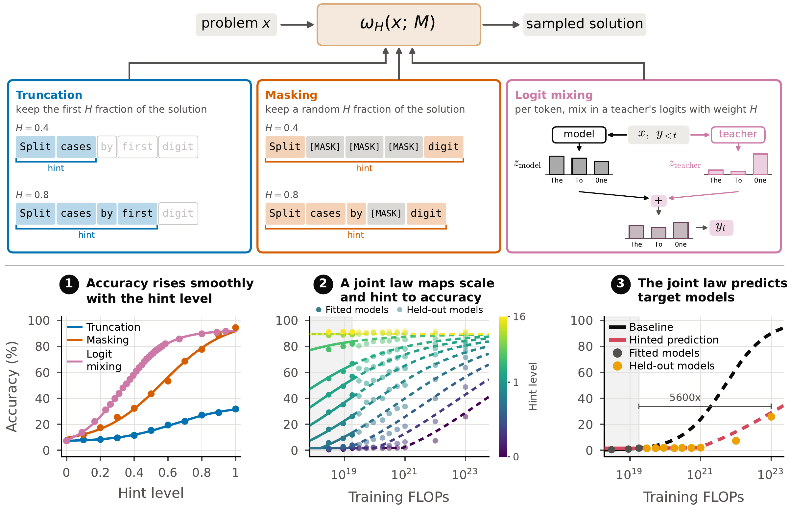

# Hinted Scaling Laws

[arXiv: link to follow]



Official implementation of *Hinted Scaling Laws*. 

Hinted scaling laws forecast a model's accuracy on a benchmark from smaller models that cannot
yet solve it by giving those models part of a reference solution (truncated, masked, or mixed in
through a teacher's logits) and fitting one law in model scale and hint level. On the Delphi
pretraining ladder, models trained with over 1000x less compute, which score near zero on GSM8K,
forecast the largest model's accuracy to within 3 percentage points, where a standard scaling
law misses by 13. Hinting also makes models easier to rank: one hinted rollout per problem
orders nearly indistinguishable models as accurately as five unhinted ones.

The hinted benchmarks themselves are on
HuggingFace as [suzeva/hinted-benchmarks](https://huggingface.co/datasets/suzeva/hinted-benchmarks).


## Install

Python ≥ 3.11, in a fresh environment that has its own `python` and `pip`:

```bash
git clone https://github.com/tatsu-lab/hinted-scaling-laws && cd hinted-scaling-laws
conda create -n hinted python=3.11 pip && conda activate hinted   # or: python3.11 -m venv .venv && source .venv/bin/activate
VLLM_USE_PRECOMPILED=1 VLLM_PRECOMPILED_WHEEL_COMMIT=a30addc7548a9a8b9b3323a7bc3eb7d7c4895d1c pip install -e .
```

The code in `src/hinted/joint_decode` is an adapted copy of
[RohithKuditipudi/joint-decode](https://github.com/RohithKuditipudi/joint-decode),
which supports both GPU and TPU backends and was used for the logit mixing
experiments in the paper. This release uses the GPU backend.

## Reproduce the figures from the released data

```bash
python experiments/forecasting/plot.py all        # every figure below
python experiments/forecasting/plot.py forecasts  # just the forecasts and their errors
```

The scripts here redraw the data, fits and curves behind the paper's figures in a plain layout,
over every (benchmark, family) pair at once; the paper's typeset figures select and arrange the
same panels differently. `plot.py` reads `data/results/` and writes next to the script:

- `marginals.pdf`: the floored sigmoid law's hint and capability marginals for every
  (benchmark, family) pair under masking and truncation.
- `forecasts.pdf`: the forecasts of the largest model's unhinted accuracy from the smallest
  models.
- `mixing_marginals.pdf`, `mixing_forecasts.pdf`: logit mixing on GSM8K x Delphi (Section 4.2)
  and on AIME x {Qwen2.5, Qwen3, Gemma-3} with and without std rescaling (the appendix on
  post-trained families).

`python experiments/forecasting/table1.py` prints Table 1 (the joint law's in-sample MAE against
independent slice fits) and the fitted parameters of every joint law, including the Delphi
logit-mixing floor.

The appendix analyses are one script each, writing next to themselves:

```bash
python experiments/forecasting/slices.py         # slices.pdf: every hint and capability slice fitted alone, all pairs (Figure 2)
python experiments/forecasting/contours.py       # contours.pdf: empirical iso-accuracy contours, all pairs (Figure 3)
python experiments/forecasting/answer_mixing.py  # answer_mixing.pdf: the answer-mixing control
python experiments/forecasting/pass_at_k.py      # pass_at_k.pdf: pass@k as a hinting method
python experiments/forecasting/two_stage.py      # two_stage.pdf: the two-stage bits-per-byte baseline on Delphi
```

To plot rollouts you generated yourself, see `experiments/query_hinted_benchmarks/README.md`.

```bash
python experiments/ranking/ranking.py certify --bench aime                # which models the holdout/ground truth can rank
python experiments/ranking/ranking.py rows --bench aime --method mask     # one ranking panel
python experiments/ranking/plot.py                                      # Section 5 / Appendix G figures
```

The ranking experiments recover the models' unhinted ranking from hinted rollouts. `certify`
lists the model pairs the deep unhinted holdout can tell apart, `rows` writes the Monte-Carlo
rows of one panel to `experiments/ranking/out/`, and `plot.py` draws `ranking.pdf` and
`ranking_lambda.pdf`. All read only `data/results/`.

## Generate new data

The paper evaluates 8 (benchmark, model family) pairs under `no_hint` (H = 0, shared by all
methods), `truncate` and `mask` (H = 0.1, …, 1.0). Logit mixing (`logit_mix`, and
`logit_mix_std` with std rescaling), where H is the teacher's weight, runs on GSM8K x Delphi
with Llama-3.1-8B-Instruct as the teacher (H = 0.1, …, 16) and on AIME x {Qwen2.5, Qwen3,
Gemma-3} with each family's second-largest model as the teacher (H = 0.11, …, 16).

**1. Run.** `launch_all.py` defines the grid and prints one fully specified command per run; `single_runner.py` executes a run on the local GPUs.

```bash
python experiments/query_hinted_benchmarks/launch_all.py                 # summarise the grid
python experiments/query_hinted_benchmarks/launch_all.py --print | bash  # run everything
python experiments/query_hinted_benchmarks/launch_all.py --sbatch        # or write Slurm job scripts

# a smoke test: 2 problems, one level
python experiments/query_hinted_benchmarks/single_runner.py --model gemma-3-270m-it --benchmark aime --method mask \
    --hint-file data/benchmarks/aime_solution_hints.jsonl --samples 10 \
    --levels 0.5 --limit 2 --out smoke.jsonl
```

Filter with `--benchmark`, `--family`, `--method`, `--max-params`; options, GPU requirements and
output paths are in `experiments/query_hinted_benchmarks/README.md`.

**2. Grade.** Rollouts are written ungraded.

```bash
python experiments/query_hinted_benchmarks/grade.py <dir>                   # GSM8K, AIME: local rules
python experiments/query_hinted_benchmarks/grade.py <dir> --mode build      # HLE: write judge requests, estimate cost
python experiments/query_hinted_benchmarks/grade.py <dir> --mode submit     # HLE: OpenAI Batch API
python experiments/query_hinted_benchmarks/grade.py <dir> --mode retrieve   # HLE: write grades back
```

HLE is graded by an LLM judge (`gpt-5.4-nano`) and needs `OPENAI_API_KEY`.


## Citation

```bibtex
Coming soon!
```
